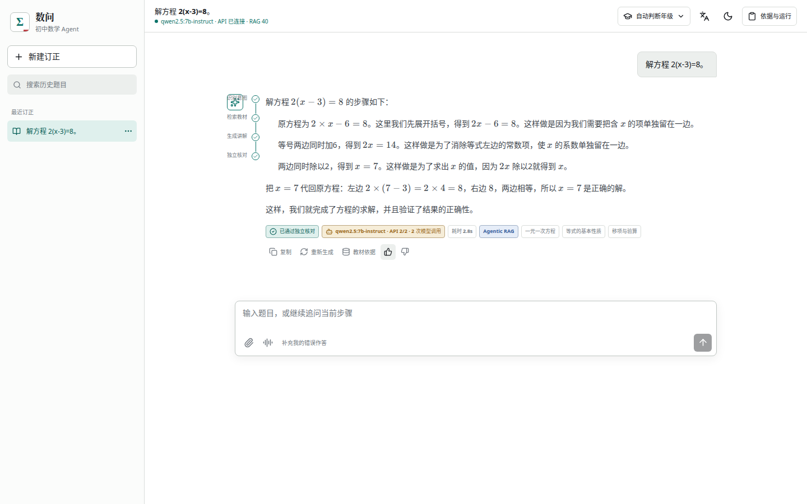
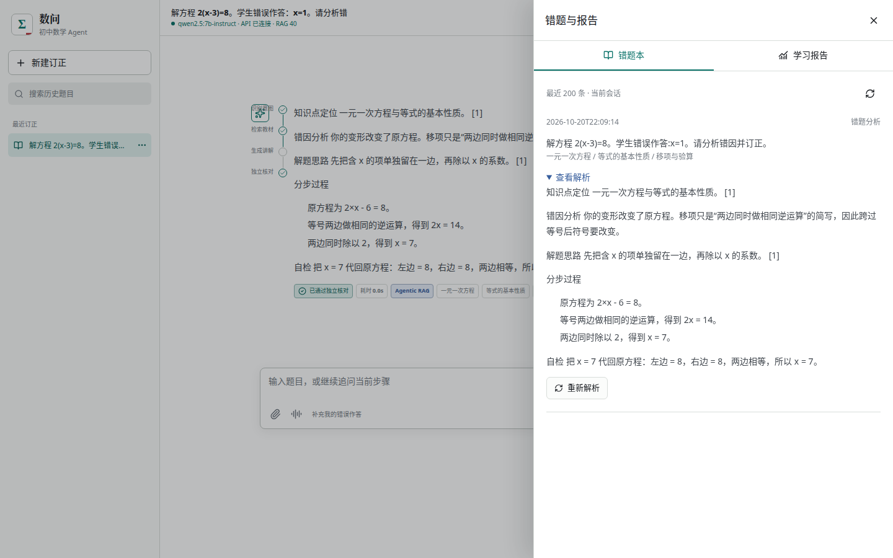
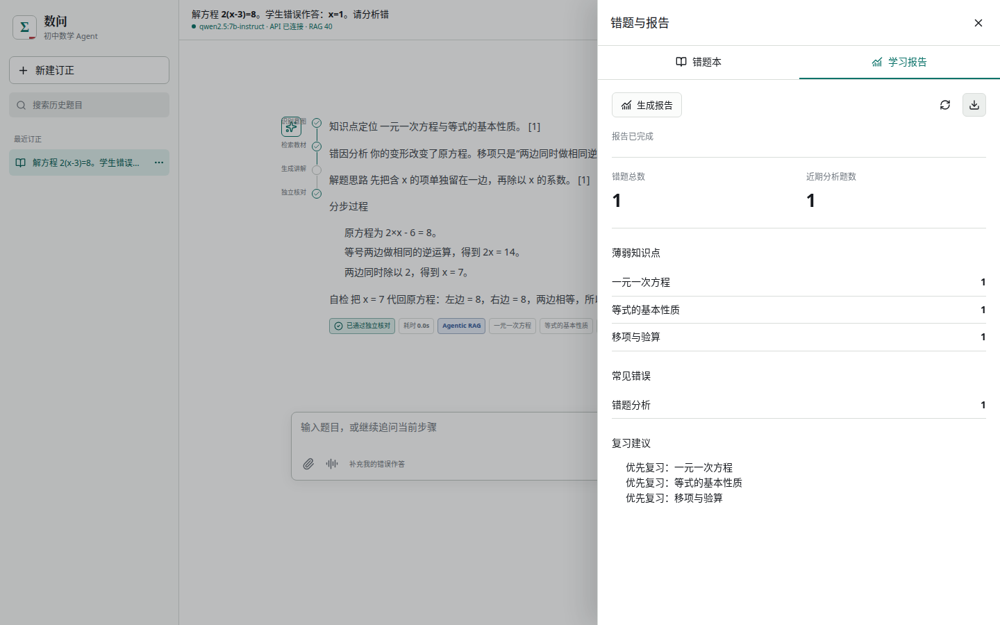
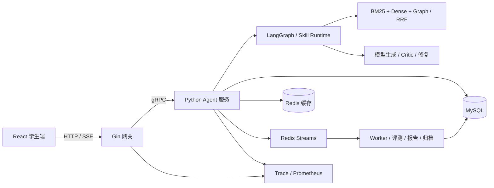

# 数问 · 初中数学错题智能问答系统

[](https://github.com/Lotus-Zou/junior-math-agentic-rag/actions/workflows/engineering.yml)
[](https://github.com/Lotus-Zou/junior-math-agentic-rag/actions/workflows/pages.yml)

**[打开数问在线体验](https://lotus-zou.github.io/junior-math-agentic-rag/)** · [浏览后端源码](https://github.com/Lotus-Zou/junior-math-agentic-rag/tree/master/agentic_rag)

面向初中数学学习场景的 Agentic RAG 应用。围绕“提问 → 解析 → 追问 → 错题归档 →
学习报告”构建完整学习流程，采用 **Gin/Go 网关 + Python Agent 服务 + gRPC** 分层架构，
将流量治理、检索生成与异步任务分别组织。

[快速运行](docs/Quickstart.md) · [架构设计](docs/Architecture.md) · [接口说明](docs/API.md) ·
[测试与评测](docs/Testing.md) · [Kubernetes 部署](deploy/k8s/README.md)

## 产品展示

在线版本使用同一套 React 学生工作台，提供六道自编数学示例、对应追问、错题本、
会话切换和学习报告下载。作答与报告只保存在访问者浏览器中，无需注册或填写密钥。
这是 GitHub Pages 静态交互展示，**不调用在线模型、不执行实时检索或 OCR**；
任意题目求解、SSE、混合检索、Critic 和异步任务由仓库中的后端提供。

本地预览在线展示：

```bash
cd frontend
npm ci
npm run dev:showcase
```

展示构建使用 `npm run build:showcase`，独立输出到 `frontend/dist/`，不覆盖后端的 `static/`。
推送 `master` 后由 [Pages 工作流](.github/workflows/pages.yml) 自动发布。

真实运行界面：数学公式渲染、分步解析、教材来源、追问与错题管理。



<details>
<summary>查看错题本与学习报告</summary>





</details>

## 核心能力

| 模块 | 实现 |
| --- | --- |
| 实时问答 | HTTP/SSE、多轮上下文、题干解析、公式渲染与来源展示 |
| 错题学习 | 错因分析、分步讲解、错题归档、同类练习与异步学习报告 |
| Agentic RAG | Query 路由、题干改写、Dense/BM25/Graph 混合检索、RRF、生成、Critic 与有限修复 |
| 流量治理 | 用户限流、有界并发、队列背压、幂等重放、熔断与异常降级 |
| 数据与缓存 | MySQL 领域模型、连接池、复合索引、进程内 L1 / Redis L2 答案缓存与检索缓存 |
| 异步任务 | Redis Streams、消费组、任务租约、重试、死信与归档去重 |
| 可观测性 | W3C Trace Context、跨服务 Trace、Prometheus 指标与健康检查 |
| 部署交付 | Docker Compose、Kustomize、多服务部署清单与 GPU 推理池配置 |

## 系统架构



### 接入与服务治理

Go 网关负责浏览器会话、HMAC 身份校验、按用户限流、并发准入、熔断及 SSE 转发。
Python 侧集中执行 Agent 工作流，通过 gRPC `Ask` / `AskStream` 提供内网接口。
幂等记录绑定请求指纹及 owner，区分已完成重放、处理中请求和请求体冲突。

### 检索与答案生成

以 BGE-M3、BM25 和轻量知识图谱构建混合检索，经 RRF 融合、重排后提供带来源的
上下文。生成、Critic 与修复分为独立 Skill，以 Schema、工具白名单、步骤数和
时间预算约束执行；数学工具支持自包含计算题核验。

### 数据与异步处理

MySQL 保存用户、会话、消息、错题、反馈、报告与任务。缓存按用户、会话、历史及
知识版本隔离；Redis Streams 将评测、报告生成和错题归档从问答链路解耦，采用
至少一次投递和幂等消费控制重复副作用。

设计取舍、数据一致性与异常处理见 [架构设计](docs/Architecture.md)。

## 快速开始

需要 Docker Compose 与可访问的模型服务。在 `.env` 中填写模型端点、模型名称、
API Key 和随机 `AUTH_SHARED_SECRET`，随后初始化依赖与知识索引：

```bash
cp .env.example .env
docker compose up -d mysql redis
docker compose run --rm --no-deps app python ingest.py
docker compose up --build -d
```

访问 <http://localhost:8080/>。Compose 中的数据库账户用于本地开发；公网部署配置
请参阅 [运行指南](docs/Quickstart.md) 和 [部署手册](deploy/k8s/README.md)。

## 工程验证

- Python：已归档 **1202 项通过**的 [JUnit 结果](docs/validation/python-engineering.xml)。
- Go：GitHub Actions 执行 `go test -race` 并构建网关镜像。
- 前端：CI 执行测试、TypeScript 类型检查和生产构建。
- 数据：提供 **1000 条程序化标注回归题**，覆盖七至九年级的 10 类知识点，附
  [数据审计](docs/validation/dataset-audit.json)、生成器与来源摘要。
- 评测：支持 Answer Relevance、Faithfulness、Recall@K、逐题配对比较与容量测量。

工程测试、检索评测和数学答案质量分别统计，命令与指标定义见
[测试与评测](docs/Testing.md)。Kubernetes/GPU 配置按部署目标执行独立验收。

## 代码导航

| 目录 | 内容 |
| --- | --- |
| `gateway/`、`proto/` | Gin 网关、身份、流控、幂等与 gRPC 协议 |
| `agentic_rag/` | LangGraph、Skill Runtime、检索、生成、校验与领域服务 |
| `app.py`、`grpc_server.py`、`worker.py` | HTTP API、gRPC 服务与异步消费者 |
| `frontend/`、`static/` | React / TypeScript 学生端与静态资源 |
| `sql/`、`deploy/` | 数据库迁移、容器和 Kubernetes 配置 |
| `evaluation/`、`tests/`、`tools/` | 数据集、评测工具、回归测试与运行脚本 |
| `docs/` | 架构、接口、运行指南与产品截图 |

## 技术栈

**后端**：Gin · FastAPI · gRPC · MySQL · Redis · Redis Streams

**智能链路**：LangChain · LangGraph · BGE-M3 · Hybrid Retrieval · RRF · Critic

**前端与交付**：React · TypeScript · Vite · KaTeX · Docker · Kubernetes · Prometheus
